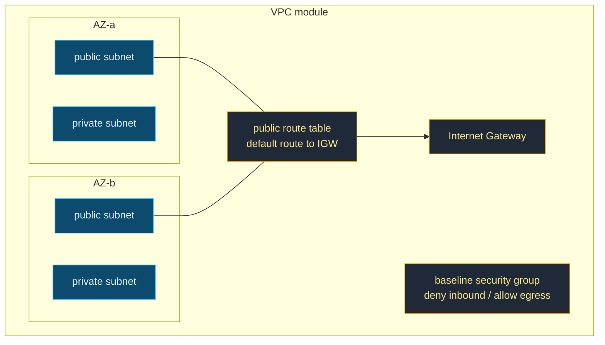
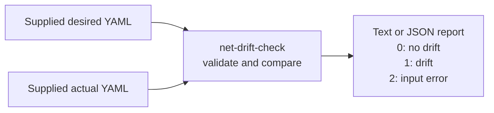

# `network` Module + Drift Check

The reusable `network` module defines a VPC, public/private subnets across
availability zones, an internet gateway, public routing, and a baseline
security group.

The Python CLI compares two supplied YAML snapshots. Each describes
subnets and DNS records, with optional security-group rules. It compares
normalized values and emits a text or JSON drift report.

The CLI reads local YAML files; it does not query AWS or read Terraform
state. See the [CLI documentation](../tools/net-drift-check/README.md) for
the input schema, normalization rules, and examples.

**OpenTofu / Terraform · consumed by `environments/dev` · no cloud
resources applied.** Subnet count is driven by the `azs` /
`public_subnet_cidrs` / `private_subnet_cidrs` variables. The two AZs shown
here are the `dev` default, not a module limit.
